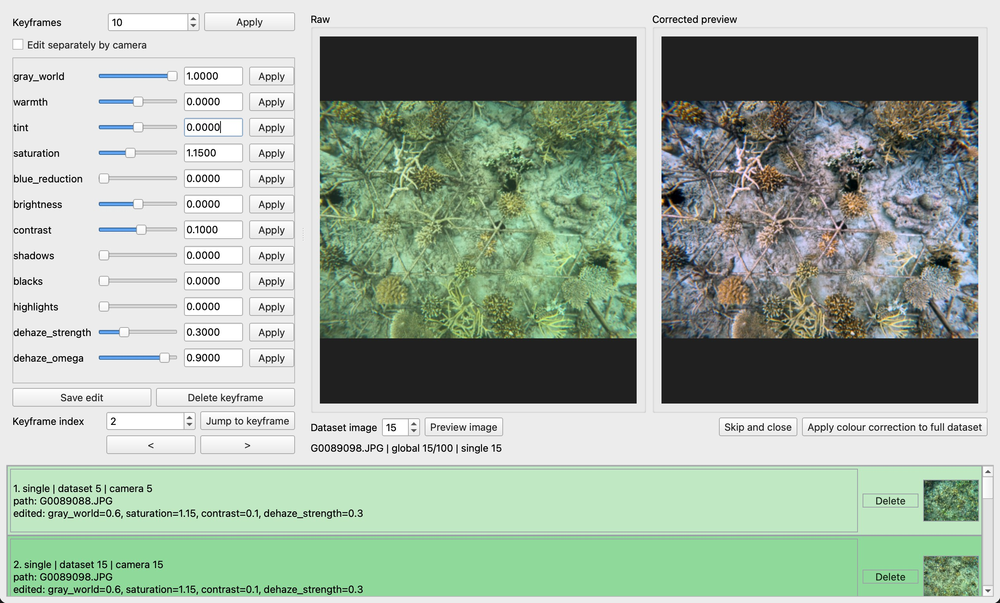

# 3DReefs

[](https://www.python.org/)
[](#requirements)
[](LICENSE)

An end-to-end pipeline for reconstructing large seabed habitats as 3D Gaussian
splats. 3DReefs combines COLMAP structure from motion (SfM), spatial patching,
LichtFeld Studio training, Wildflow cleaning and merging, compression with SOG 
and optional colour correction.

**Paper:** *A Protocol for Producing 3D Gaussian Splats of Large Seabed
Habitats* — link coming soon.<br>
**Datasets:** download links coming soon.

<div align="center">
  <video src="https://github.com/user-attachments/assets/08323a9a-de81-48b0-a339-792b7b74f0d2"
    width="100%" autoplay loop muted playsinline></video>
  <em>Video of a cleaned, merged, and colour corrected SOG compressed 3DGS model
  constructed from 8,774 GoPro HERO1 Black images using 3DReefs.
  Test out an interactive version of another one of our reefs
  <a href="https://superspl.at/scene/7ef6cbdb">here</a>.</em>
</div>

## Pipeline

Each run reads images from `<project.dir>/raw_images/` and writes everything
else to its own folder, `<project.dir>/runs/<run-id>/`. Paths below are relative
to that run folder.

| Stage | Step (`--steps` name) | Reads | Writes |
| --- | --- | --- | --- |
| Reconstruction | SfM and undistortion (`sfm`) | `raw_images/` | `sfm/refined_sparse/final/` (camera poses and sparse points); `sfm/undistorted/` (undistorted images and model) |
| | Colour correction (optional; runs in `splat.preflight`) | `sfm/undistorted/images/` | `colour_restoration/outputs/undistorted/images/` |
| | Camera outlier removal (`splat.outlier_filter`) | `sfm/undistorted/sparse/` | `splat/outlier_filter/filtered_sparse/` |
| | Patching (`splat.patch`) | filtered model and images | `splat/patches/p000/`, `p001/`, … (each with `selected_images/` and `sparse/0/`) |
| | Training (`splat.train`) | each patch folder | `splat/patches/pNNN/splat/splat_finished.ply` |
| Post-processing | Cleaning (`splat.cleanup`) | each `splat_finished.ply` | `splat_finished_clean.ply` beside it |
| | Merging (`splat.merge`) | cleaned patch PLYs | `splat/merged/merged_splat.ply` |
| | Compression (`splat.sog`) | `merged_splat.ply` | `splat/merged/merged_splat.sog` |

Every run also records `effective_config.yml`, `run_manifest.json`,
`run_status.json`, `timings.json` and `logs/`, so it can be inspected and
resumed. The final outputs are `merged_splat.ply`, the complete cleaned 3DGS
model, and `merged_splat.sog`, a compressed copy for fast interactive viewing.
To view your model, upload the SOG file to PlayCanvas's
[SuperSplat](https://superspl.at/editor) in a web browser.

## Requirements

3DReefs targets Linux and NVIDIA GPU's. The reproducible Docker image is the
recommended installation because COLMAP and LichtFeld Studio require compiled
CUDA toolchains.

The reference systems used for development and experiments were:

| Machine | Tested hardware |
| --- | --- |
| Local workstation (development and post-processing) | Ubuntu 24.04; AMD Ryzen Threadripper PRO 9965WX (24 cores); NVIDIA RTX PRO 6000 Blackwell Max-Q (96 GB VRAM); 512 GB RAM |
| Nebius cloud node | One NVIDIA H100 SXM GPU; 16 vCPUs; 200 GB RAM; 960 GiB network-SSD boot disk |

These are tested configurations, not minimum requirements. Runtime, storage and
VRAM needs depend strongly on image count, resolution and scene extent.
Capabilities on image datasets larger than those presented in our paper (approx.
12,000 images) should be considered unverified.

The controlled software stack is Python 3.12, [uv](https://docs.astral.sh/uv/),
[COLMAP](https://colmap.github.io/) 4.0.4 (`9c23f694`),
[LichtFeld Studio](https://github.com/MrNeRF/LichtFeld-Studio)
0.5.2-dev (`6d591a34`), Wildflow 0.1.5 and
[`splat-transform`](https://github.com/playcanvas/splat-transform) 1.10.2.
Changing these versions can change scientific results.

## Installation

Clone the repository and run all commands below from its root folder:

```bash
git clone https://github.com/ben-williams-ai/3DReefs.git
cd 3DReefs
cp .env.example .env
```

SIFT loop detection requires a COLMAP vocabulary tree, which is not included
in this repository. Download `vocab_tree_faiss_flickr100K_words256K.bin` from
the [COLMAP vocabulary-tree models](https://demuc.de/colmap/), keep it outside
the repository, and set `VOCAB_TREE_PATH` in `.env` to its location.

Then choose **one** of the two options below. You do not need both.

### Option 1 (recommended): Docker

Install Docker Engine and the NVIDIA Container Toolkit, then build and verify
the complete pinned toolchain:

```bash
scripts/docker/build_image.sh
scripts/docker/check_gpu.sh
scripts/docker/verify_colmap_gpu_ba.sh
```

Run the bundled end-to-end smoke dataset after building:

```bash
scripts/docker/run_test_dataset_e2e.sh
```

See [Docker and Nebius workflow](docs/docker-nebius.md) for host
installation, mounted paths and reproducible cloud execution.

### Option 2: Manual install

Install Python 3.12 and
[uv](https://docs.astral.sh/uv/getting-started/installation/), then install the
locked Python environment (including Wildflow):

```bash
uv sync --frozen --dev
```

Then install compatible CUDA builds of COLMAP and LichtFeld Studio plus
`splat-transform`, and set their paths in the manual-install section of `.env`.
The Dockerfile is the reference build recipe and exact source of version pins.

Check the command-line interface:

```bash
uv run main.py --help
```

## Prepare a dataset

Good data collection is absolutely key, this underpins final reconstruction
quality. We recommend gathering your images following a framework such as the
Wildflow data collection protocol, available
[here](https://docs.wildflow.ai/photogrammetry/gopro) (note 3DReefs does not
require corner markers or scale bars), or the Australian Institute of Marine
Science (AIMS) photogrammetry protocol. In addition to these guides: i) avoid
days with strong sunlight rippling across the seabed (caustics); a cloudy day is
ideal; ii) consider swimming the 'lawnmower' pattern both ways (up and down,
then side to side); iii) avoid fisheye lenses, and set cameras to 'Linear' or
'Narrow' mode.

Create one project directory per survey. Put single-camera datasets directly
in `raw_images/`, or preserve one subdirectory per camera if multiple cameras
were used:

```text
my_dataset/
  raw_images/
    cam1/
      image_000001.jpg  # Any filenames work; capture order should sort correctly.
      image_000002.jpg
    cam2/
      image_000001.jpg
      image_000002.jpg
```

Keep original filenames, full image resolution and metadata, and preferably do
not rename images. 3DReefs orders images by their capture time when every image
has it in its metadata; otherwise it falls back to filename order. If renamed
images lose that metadata and their filenames no longer sort in capture order,
reconstruction will likely fail.

Copy `configs/example.yml` and edit its mandatory section: choose the
colour-correction mode and set `project.dir`. You can leave the tool and
vocabulary-tree paths unchanged; they are filled in from `.env` (or, in
Docker, from the image).

```bash
cp configs/example.yml configs/my_dataset.yml
```

The advanced section already contains the recommended defaults from the
cross-dataset ablations detailed in our paper: 1024-pixel SIFT feature
extraction with COLMAP's global mapper, followed by 2048-pixel training with at
most 200 cameras and 2 million Gaussians per patch. Most users should begin with
these settings and only change them for a hardware or experimental reason.

## Run the full pipeline

This command reconstructs, trains every valid patch, cleans and merges the
patches, and exports the compressed SOG file:

```bash
uv run main.py \
  --config configs/my_dataset.yml \
  --run-id my_dataset_v1 \
  --steps sfm,splat,splat.postprocess \
  --resume-policy overwrite
```

Use a unique run ID. To avoid overwriting expensive partial outputs, continue
an interrupted run by repeating the same command with `--resume-policy resume`
in place of `--resume-policy overwrite`.

The same pipeline can be run one stage at a time with the same run ID:

```bash
# Validate images, configuration and external tools.
uv run main.py --config configs/my_dataset.yml --run-id my_dataset_v1 --steps sfm.preflight

# Estimate cameras and sparse 3D structure, then undistort the images.
uv run main.py --config configs/my_dataset.yml --run-id my_dataset_v1 --steps sfm --resume-policy resume

# Divide the reconstruction into spatial camera groups.
uv run main.py --config configs/my_dataset.yml --run-id my_dataset_v1 --steps splat.patch --resume-policy resume

# Train every selected Gaussian patch.
uv run main.py --config configs/my_dataset.yml --run-id my_dataset_v1 --steps splat.train --resume-policy resume

# Clean, merge and export the trained patches.
uv run main.py --config configs/my_dataset.yml --run-id my_dataset_v1 --steps splat.postprocess --resume-policy resume
```

For Docker jobs from a pinned Git commit, use
`scripts/docker/run_job_from_git.sh`; its required mounts and variables are
documented in the [cloud workflow](docs/docker-nebius.md).

## Colour correction

3DReefs includes some basic tooling to correct the colour of underwater images,
for example removing the green wash common in underwater images. Example before
and after images are presented in the paper.

Colour correction never changes the raw images used for SfM. Instead, after SfM
it saves a corrected copy of the undistorted images in the run's folder, and
only splat training uses them. This keeps camera geometry and colour treatment
independent.

Choose a mode with `colour_restoration.mode` at the top of your dataset config:

| Mode | What it does |
| --- | --- |
| `off` | No colour correction (default). |
| `gray_world` | Automatic correction that usually improves colour. |
| `manual` | Opens the colour editor so you can correct the colour yourself. Best results. |
| `profile` | Reapplies a correction saved from an earlier `manual` run, without the editor. |

In `manual` mode the editor shows 10 evenly spaced images (keyframes) from your
dataset. Adjust each one, click **Save edit**, then **Apply colour correction to
full dataset**. Your settings are blended between keyframes to correct every
image, and saved as a profile in
`<project.dir>/runs/<run-id>/colour_restoration/profile.json`.

<div align="center">
  
  <em>The colour editor in <code>manual</code> mode: adjust a keyframe on the
  left and compare the raw image with the corrected preview.</em>
</div>

To reuse that correction in a later run, copy the profile next to your config
and point to it:

```yaml
colour_restoration:
  mode: profile
  profile_path: colour-profiles/my_dataset_colour.json  # relative to the config file
```

See `uv run main.py colour --help` for standalone colour commands.

## Nebius

The complete setup, storage layout, image pinning and success checks are in
[Docker and Nebius workflow](docs/docker-nebius.md). Never place cloud
credentials in configs, shell scripts or Git.

Nebius jobs use Object Storage as the durable source of truth and disposable
GPU Virtual Machine disks as scratch space during runs. Install the
[Nebius CLI](https://docs.nebius.com/cli/install), authenticate it, configure
AWS CLI access to Object Storage, and push the Docker image once. Ordinary
production runs use `scripts/nebius/launch_production_job.sh`; replicating the
paper's ablations uses the guarded experiment wrappers.

## Reproduce the papers experiments

The ordinary pipeline above is for producing your own 3DGS models. The Stage 1
SfM and Stage 2 Gaussian-splat ablation experiments presented in the paper use
separate runners, held-out image evaluation and result ledgers. See
[experiments/README.md](experiments/README.md) for further details.

## Tests

Run the local test suite with:

```bash
uv run pytest
```

GPU/toolchain integration checks are separate:

```bash
scripts/docker/check_gpu.sh
scripts/docker/verify_colmap_gpu_ba.sh
scripts/docker/run_test_dataset_e2e.sh
```

## Citation and licence

Citation details will be added when the paper is public. 3DReefs is released
under the [BSD 3-Clause License](LICENSE).

### Third-party software

3DReefs installs or calls the software below, which keeps its own licence. None
of it is copied into this repository.

| Component | How 3DReefs uses it | Licence |
| --- | --- | --- |
| [COLMAP](https://github.com/colmap/colmap) | Structure from motion; built in the Docker image | BSD 3-Clause |
| [Ceres Solver](https://github.com/ceres-solver/ceres-solver) | COLMAP dependency; built in the Docker image | BSD 3-Clause |
| [LichtFeld Studio](https://github.com/MrNeRF/LichtFeld-Studio) | Gaussian splat training; built in the Docker image | GPL-3.0 |
| [Wildflow](https://pypi.org/project/wildflow/) | Splat cleaning and merging; Python dependency | MIT |
| [splat-transform](https://github.com/playcanvas/splat-transform) | SOG compression; installed in the Docker image | MIT |
| [PySide6](https://pypi.org/project/PySide6/) | Colour editor window; Python dependency | LGPL-3.0 |

This is a practical summary, not legal advice; see each project for its full
licence terms. Other Python dependencies are listed in `pyproject.toml` and
`uv.lock`.
